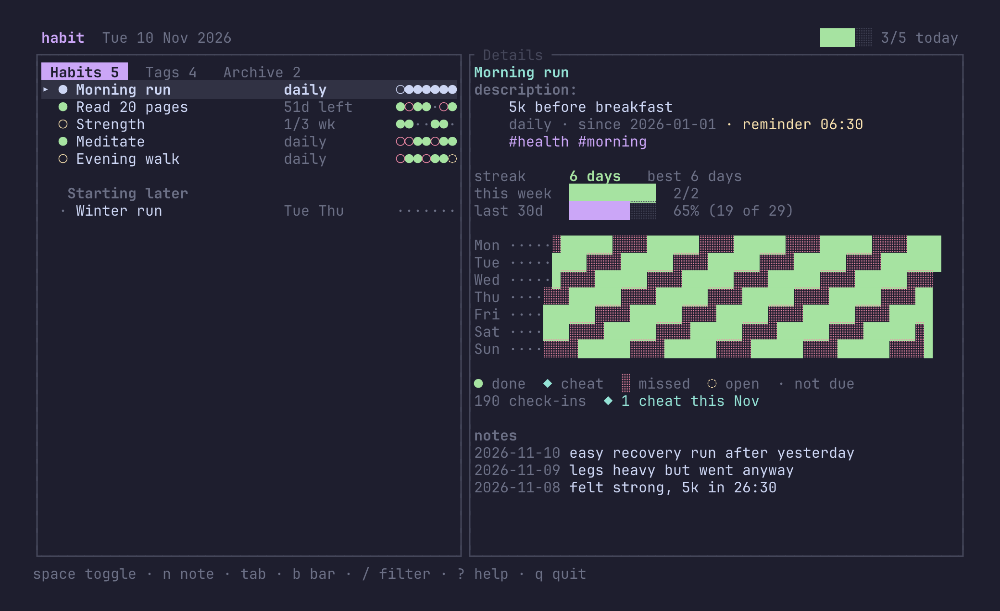
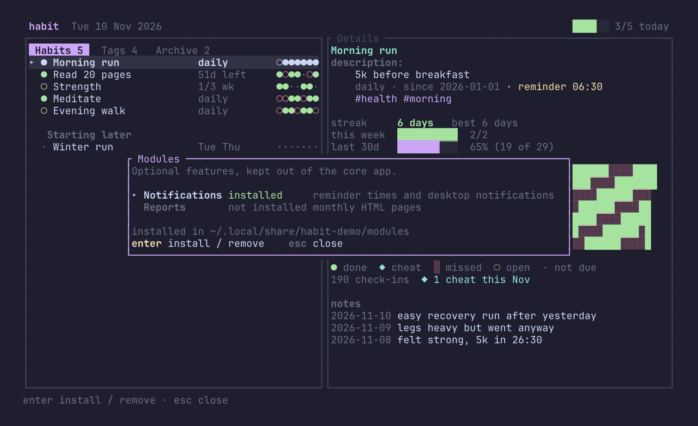
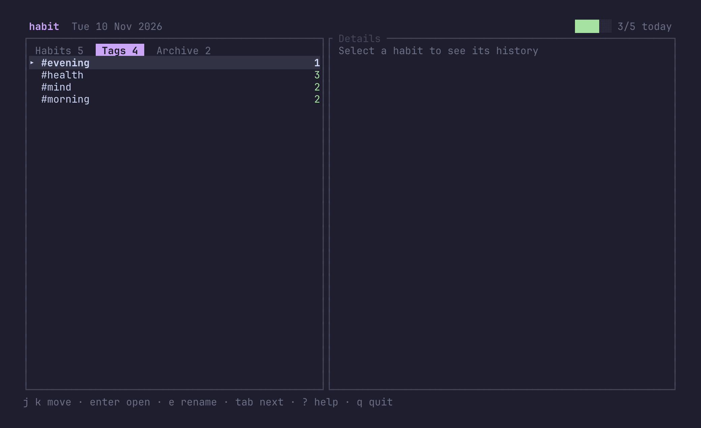
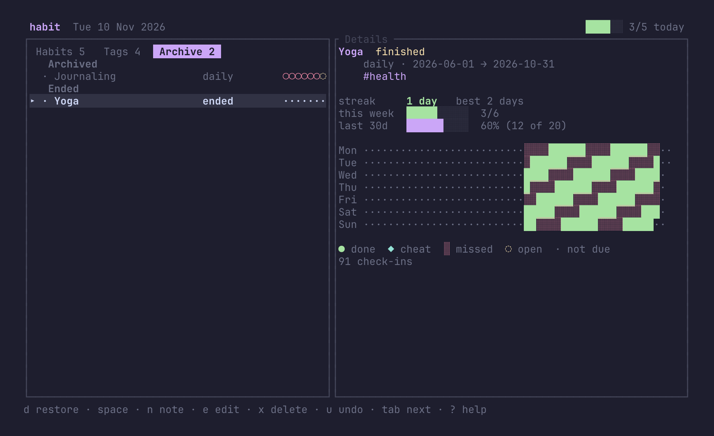
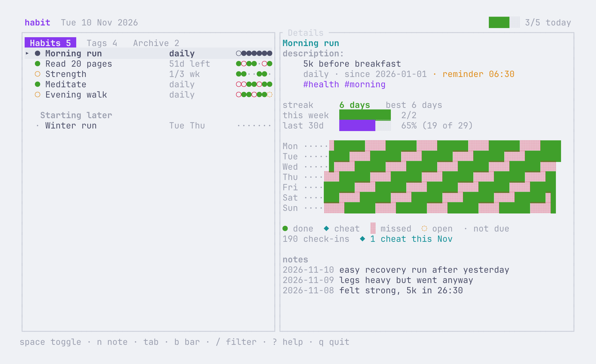
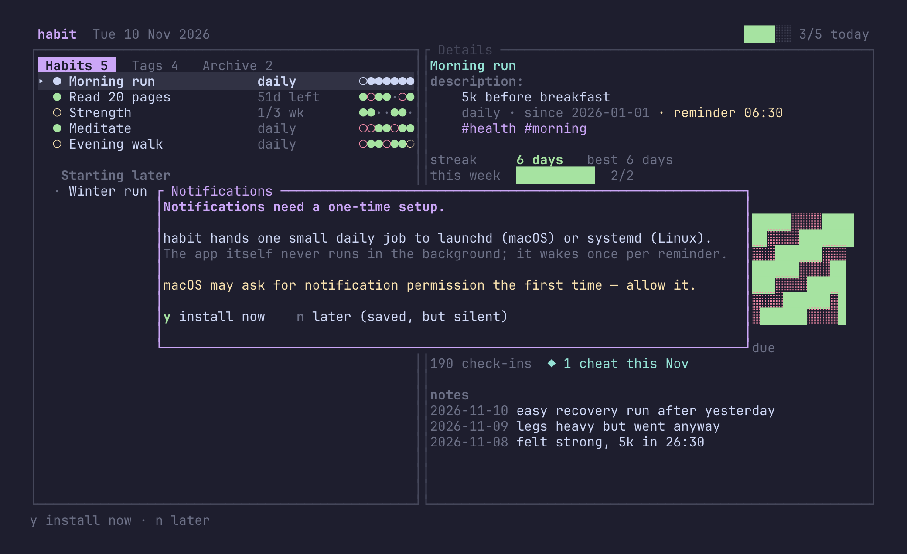
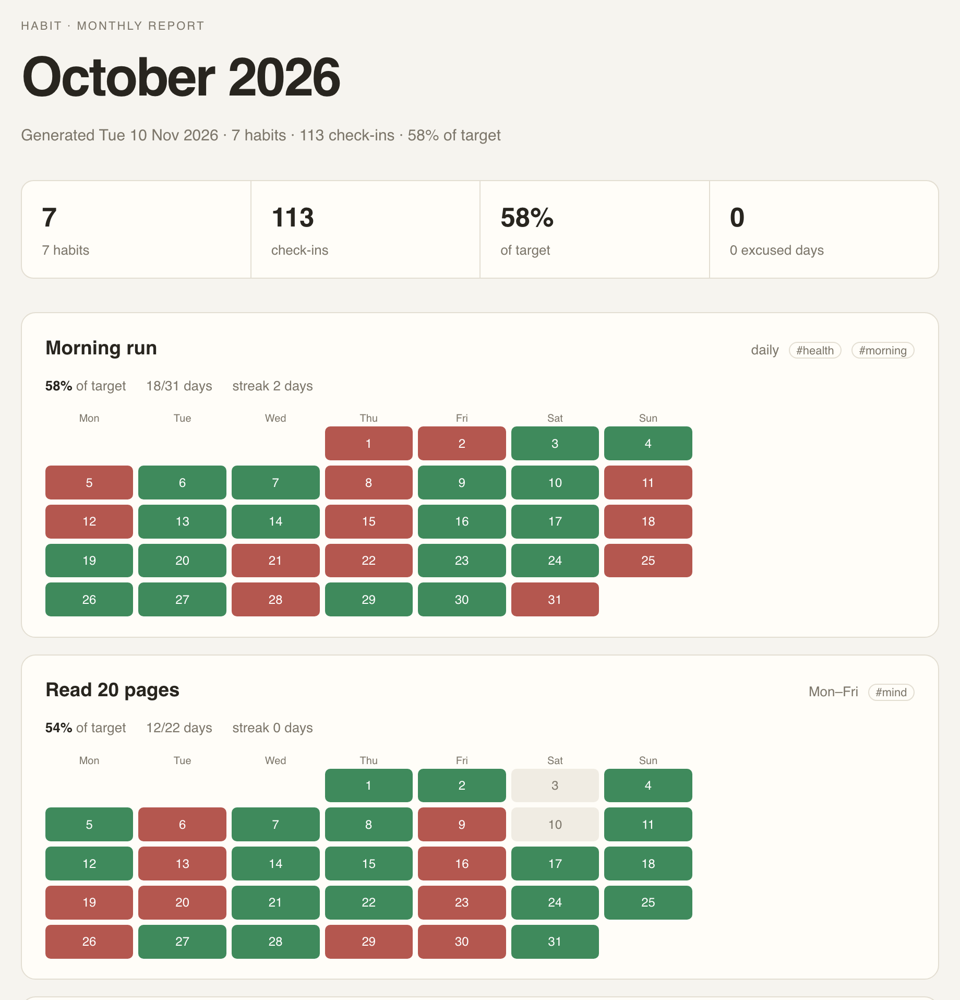
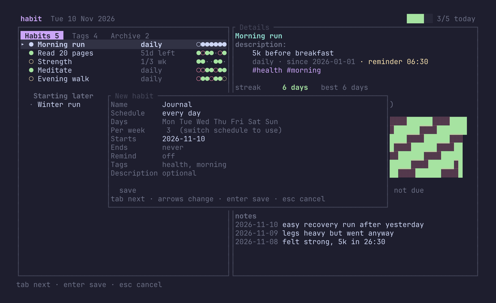
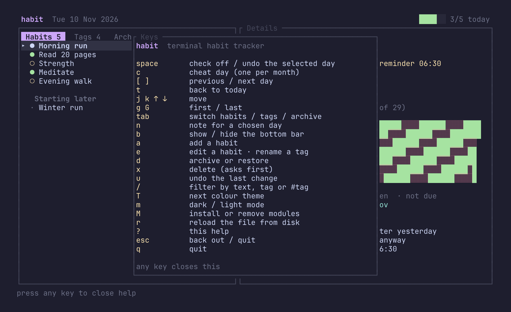

# habit

**A calm habit tracker for the terminal.** Streaks, weekly quotas, cheat days, tags, descriptions,
dated notes, per-habit reminders, monthly HTML reports and a heatmap — plus a plain JSON file you
can read, diff and `grep`. A small Rust core, with reminders and reports installed only when you
want them, and no daemon, no account and no network access.

[](https://github.com/Vulkan1125/habit-tracker/actions/workflows/ci.yml)
[](LICENSE)
[](Cargo.toml)



## Features

### Two interfaces, one program

Run `habit` and you get a full-screen TUI. Run `habit done gym` and you get a scriptable CLI. Both
read and write the same file, so terminal widgets, cron jobs and shell aliases all see the same
state. The TUI can now act on any past day, so backfilling no longer needs a second tool.

### Optional modules — install what you need

The core app tracks habits. Two larger features ship as companion binaries and are installed only
when you ask for them:

```sh
habit modules list              # installed, not installed, or unavailable in this build
habit modules install notify    # reminder times and desktop notifications
habit modules install report    # monthly HTML pages
habit modules remove report     # uninstall it and stop its scheduled job
```

`habit modules` on its own is the same as `list`. In the TUI, `M` opens the modules screen; `enter`
or `space` installs or removes the highlighted module. Modules live in `<data dir>/modules`, beside
the data file, so each data file carries its own feature set. Installing copies the binary that
shipped with `habit` — a release archive, Homebrew cellar or `cargo install` — and never uses the
network.

Without the notifications module there is no **Remind** field, no reminder line in the detail pane
and no `habit remind`; without the reports module there is no `habit report`. The commands name the
exact module to install when you reach for something that is missing. Saved reminder times are kept
when a module is removed, so reinstalling it brings the feature back.



### Schedules that match real life

| Schedule | Use it for | Streak counts |
| --- | --- | --- |
| `daily` | meditation, flossing | consecutive days |
| `mon,wed,fri` | gym, language class | consecutive *due* days — off days never break it |
| `4×/week` | “move four times a week” | consecutive *complete weeks* |

A quota habit is never “missed” on a Tuesday just because you went on Monday: only the weekly
total matters. Day-of-week habits skip their off days entirely, so a Mon/Wed/Fri streak isn't
reset by Thursday.

### Start and end dates

Every habit has a start date and may have an inclusive end date:

```sh
habit add "Read 20 pages" --start 2026-11-01 --end 2026-12-31
habit start read-20-pages 2026-11-05
habit end read-20-pages --date 2026-12-15
habit end read-20-pages --clear
```

Days outside that window are **not due**, not misses. A habit with an end date trades its schedule
label for a countdown (`51d left`, then `last day`), turning amber in the final three days; once the
date passes the row reads `ended`, the detail pane calls it `finished`, it sorts with archived
habits, and its streak freezes on its final day instead of decaying forever. Both dates are
editable in the TUI's add/edit dialog.

### Cheat days — one per calendar month

Life happens. Mark a day as a cheat day and the streak skips it exactly like a non-due day. Each
habit gets **one excused day per calendar month**; the second one in the same month is an ordinary
miss and breaks the streak. The UI says so before it happens.

```sh
habit cheat gym                 # excuse today
habit cheat gym --date 2026-11-06
habit cheat gym --off           # remove it again
```

- Cheat days never count as completions and are excluded from the completion-rate denominator.
- They do not fill a weekly quota — otherwise `4×/week` would become “cheat four times a week”.
- The first cheat in a month is `◆` in its own colour; later ones render as missed days, so the
  difference is always visible.
- Archive and delete carry cheat days along with check-ins.
- If you backfill an *earlier* cheat into a month that already has one, the earlier date becomes the
  excused one and the UI warns that the later one now breaks the streak.

### Streak rules, explicitly

- A day that is **not due** is skipped, not counted as a miss.
- **Today** being unfinished never breaks a streak; it renders as `◌` (open) rather than a miss.
- **Quota habits** count complete weeks. A half-finished week leaves the streak at its previous
  value instead of zeroing it, and the list shows `2/4 wk` meanwhile.
- Days **before the start date** and **after the end date** are never shown as misses.
- **The first cheat day** in a calendar month is skipped; any later one counts as a miss.
- Checking off a **non-due day** is allowed and counts as extra credit (useful after a reshuffle).
- Longest streak is kept separately from the current one, so a broken streak doesn't erase history.

### Tags, descriptions and dated notes

Tags are normalised to lowercase kebab-case, de-duplicated and sorted: `#Health & Focus` becomes
`health-focus`. A habit's **description** is free text and appears wrapped in the detail pane.
**Dated notes** are separate: one note per habit per day, listed newest first with the date on the
left.

```sh
habit add "Morning run" --tag health --tag morning --description "5k before breakfast"
habit tag gym health cardio       # add tags
habit tag gym cardio --remove     # remove one
habit tags                        # every tag with a habit count
habit rename-tag health fitness   # rename everywhere; merges if the name is taken
habit merge-tags morning mind     # fold one tag into an existing one
habit list --tag health           # AND: every listed tag must match
habit describe gym "ten minutes is enough"
habit describe gym                # print the current description
habit describe gym --clear
```

`habit note` remains an alias for `habit describe`, and `habit add --note` still sets the
description for compatibility.

In the TUI, `tab` cycles the left pane through **Habits**, **Tags** and **Archive**. The Habits
tab shows what is running today, with habits whose start date is still ahead under a **Starting
later** heading. The tag list shows each tag with its count of still-active habits; open a tag with
`enter`, `space` or a click to see its active habits and, under an **Archive** heading, the archived
or finished ones. The Archive tab collects closed habits under **Archived** and **Ended**; press
`d` there to restore or archive. Press `e` on the tag list to rename the tag under the cursor: the
name is rewritten on every habit that carries it, and typing a name that is already in use asks
whether to merge the two, so a typo cannot silently create a near-duplicate tag.



Press `n` to write or edit a note — right after checking a habit off is the natural moment. The
dialog opens on the day you are looking at (today unless you moved with `[` / `]`), and `tab` moves
into its date field if you want another day: `↑` / `↓` step one day and typing takes any
`YYYY-MM-DD`. A date in the future or before the habit started is refused with an inline message
and the dialog stays open; `esc` cancels, and saving an empty note removes it. Dates are shown on
the left, notes on the right, newest first.

In the TUI press `/` and type. `#health` matches tags, while plain words match the name, id, tags
and description. Multiple tokens are ANDed, so `run #morning` narrows to morning runs.

### The TUI

- **Habits, Tags and Archive tabs** in the left pane, cycled with `tab` and clickable with the
  mouse. Habits that start in the future sit under a **Starting later** heading, so today's list
  stays about today. Each tag shows its active-habit count; opening one splits active habits from
  archived and finished ones under an **Archive** heading. On the tag list `e` renames the tag
  under the cursor, or merges it into another tag after asking. The Archive tab groups closed
  habits under **Archived** and **Ended**.
- **Habit rows** with the selected day's marker, a 7-day dot strip and weekly quota progress.
  Habits with an end date replace the schedule label with a countdown (`51d left`, `last day`,
  `ended`), turning amber in the final three days.
- **Date navigation** (`[` `]`, `t` for today): check off, excuse, inspect or annotate any past day.
- **Detail pane** with `description:` directly under the habit title, and the description text,
  schedule line and tags all indented beneath it, then current and best streak, this week's bar,
  30-day completion, an adaptive heatmap (up to 52 weeks) and dated notes (date left, note right).
- **Dated notes**, newest first: press `n` after checking a habit off to journal the day, or `tab`
  inside the dialog to file it under another date (never the future, never before the habit's
  start); empty input removes the note and edits are covered by undo.
- **Hideable bottom bar**: `b` reclaims the hint line and gives the panes one more row.
- **Add/edit dialog** with schedule picker, weekday toggles, start/end dates, a reminder time, tags
  and description — all validated inline. A time in **Remind** is what opts a habit into
  notifications; leaving it empty keeps it silent.
- **Instant feedback** in the status line, including streak effects and a warning when a second
  cheat in a month will break the run.
- **One-step undo** for every mutation — check-off, cheat, add, edit, rename/merge a tag, archive
  and delete.
- **Archive instead of delete**: history is kept, the habit leaves the Habits tab and `d` moves it
  between the Archive tab's **Archived** and **Ended** groups.
- **Tag-aware filter** (`/`), **help overlay** (`?`), **reload from disk** (`r`), and a one-time
  **notification setup** prompt the first time a reminder is enabled.
- **Theme switching without editing a file**: `T` steps through the seven palettes and `m` flips
  dark/light; both are written back to `config.toml` immediately.
- **Responsive**: below 72 columns the detail pane collapses and the list takes the full width.
  Footer hints and the detail legend shorten themselves on narrow terminals.

Closed habits keep their history and their detail pane:



### Themes, in light and dark

Seven palettes ship with both modes:

| Theme | Mood |
| --- | --- |
| `terminal` | inherits your terminal's own foreground/background and ANSI colours |
| `rosepine` | muted rose, pine and foam |
| `catppuccin` | soft pastels |
| `tokyonight` | deep indigo and neon accents |
| `gruvbox` | warm retro amber and olive |
| `evergreen` | calm green and teal |
| `mono` | no colour at all: weight and glyphs carry the meaning |

```toml
theme = "catppuccin"
mode = "light"          # dark | light
```

Colours are defined in truecolour and downgraded automatically to the 256-colour cube, then to
the nearest of the basic 16 colours when the terminal does not advertise better support (16-colour
mode also leaves your background untouched). Each habit gets a stable accent derived from a hash
of its id, so its colour survives sessions without being stored. `habit themes` lists the names.

The same file in light mode, with `mode = "light"`:



### The CLI

Every action is a subcommand, with real exit codes:

```console
$ habit add "Gym" --weekly 4 --tag health --start 2026-09-14
added Gym [gym] · 4×/week · since 2026-09-14
  tags #health

$ habit done gym
✓ Gym on 2026-11-10 · 1/4 this week

$ habit cheat gym --date 2026-11-06
◆ Gym on 2026-11-06 · excused (1/1 cheat day in November)

$ habit done read --date 2026-11-09      # backfill a missed day
✓ Read 20 pages on 2026-11-09 · streak 1 day

$ habit list --tag health
ID       HABIT         SCHEDULE      TODAY STREAK
gym      Gym           4×/week           · 1 week
run      Morning run   daily             ✓ 3 days

$ habit stats --habit gym --days 90
Gym · 4×/week · since 2026-09-14
  #health
  streak       1 week (best 3 weeks)
  this week    1/4
  completion   77% (28 of 36) over 90 days
  check-ins    28
  cheat days   1 this month (limit 1)
```

### Data safety

- **Atomic writes**: temp file → `fsync` → `rename`. A crash mid-save cannot truncate your history.
- **Automatic backup**: the previous version is kept as `data.json.bak` on every save.
- **Version guard**: a file written by a newer format is refused instead of silently mangled.
- **Version upgrade**: an older file loads with the new fields defaulted and is stamped as the
  current format on its next save, so old data is not stranded.
- **Tolerant loading**: a missing or empty file means “no habits yet”, not an error.
- **Hand-editable**: plain, pretty-printed JSON, and `r` reloads it without restarting.
- **Failed saves revert the change in memory**, so the screen never lies about what's on disk.

### Per-habit reminders, without a daemon

The notifications module (`habit modules install notify`) adds **opt-in per-habit reminders**:
nothing is scheduled until a habit gets a time. Set one in the add/edit dialog's **Remind** field,
or from the shell:

```sh
habit add "Morning run" --remind 06:30
habit remind-time gym 18:00     # set or change a habit's time
habit remind-time gym           # print the current time
habit remind-time gym --clear   # turn it off
```

`habit remind` is a single process: it reads the file, works out what is still open — quota habits
only nudge while their week is short, and done, excused and finished days are skipped — then asks
the desktop for a notification. On macOS that is `osascript`, on Linux `notify-send`; elsewhere it
prints the text. Nothing stays running, and no network is involved. `--at HH:MM` limits a run to
the habits with that time, which is how one OS job per time shares the command.

The first time a reminder is switched on, the TUI explains the one-time setup and offers to install
it; choosing **later** keeps the time saved but silent, so no scheduler job is created without your
say-so.



The OS scheduler does the waking:

```
$ habit schedule install
reminders installed for 06:30, 18:00, 19:30 · 3 times
  ~/Library/LaunchAgents/com.habit.reminder.0630.plist
  ~/Library/LaunchAgents/com.habit.reminder.1800.plist
  ~/Library/LaunchAgents/com.habit.reminder.1930.plist
$ habit schedule status
loaded               ~/Library/LaunchAgents/com.habit.reminder.0630.plist
loaded               ~/Library/LaunchAgents/com.habit.reminder.1800.plist
loaded               ~/Library/LaunchAgents/com.habit.reminder.1930.plist
$ habit schedule remove
```

macOS gets one launchd agent per distinct reminder time; Linux gets a
`habit-reminder-HHMM.service` plus `.timer` pair in `~/.config/systemd/user`. Both units carry the
absolute binary and data path, so a minimal scheduler `PATH` does not matter. Re-running `install`
syncs: it writes a unit for each time in use and removes units for times no habit uses any more,
including the single-unit names from 0.6.0. `--dry-run` prints the files without touching the
system. macOS may ask for notification permission the first time a notification is posted — allow
it once, and the rest arrive quietly.

### Monthly HTML reports

The reports module (`habit modules install report`) writes one self-contained page per month —
inline CSS, no scripts, no fonts to download and no network — to
`<data dir>/reports/habit-YYYY-MM.html`:

```sh
habit report                    # this month, on demand
habit report --month 2026-10
habit report --last-month --open
habit report --output ~/Desktop/habits.html
```

Every habit gets its completion rate, quota weeks met, current streak, excused days and a day-by-day
calendar using the same four statuses as the TUI. It reads well in a browser, prints cleanly, and
can be committed, attached to a mail or turned into a PDF.



To have it happen by itself, schedule it:

```sh
habit schedule reports install              # day 1 at 09:00
habit schedule reports install --day 7 --at 18:00
habit schedule reports status
habit schedule reports remove
```

The job runs `habit report --last-month --notify`: on the chosen day you get last month's page and a
notification carrying its path. The day must be 1–28 so every month has it; the default is the 1st.

### Small on purpose

No database, no sync, no telemetry, no async runtime, no plugin API. Nine direct dependencies, all
mainstream. The core `habit` binary stays around 2 MB; the optional modules add a little more only
when you install them.

## Installation

macOS, with [Homebrew](https://brew.sh):

```sh
brew install Vulkan1125/tap/habit
```

Linux, one line:

```sh
curl -fsSL https://github.com/Vulkan1125/habit-tracker/releases/latest/download/install.sh | sh
```

The installer checks the download against the release's `SHA256SUMS` and installs all three
binaries — `habit`, `habit-notify` and `habit-report` — so `habit modules install …` works offline.
On Debian/Ubuntu (`apt-get`), Fedora/RHEL (`dnf`/`yum`) and Arch (`pacman`) it uses the native
package; everywhere else, including macOS, it unpacks the prebuilt binaries into `~/.local/bin`
without needing root.

If no prebuilt build exists for your platform (Linux arm64, for example), it compiles from source.
Rust is detected first: when `cargo` is missing the installer offers to set it up with
[rustup](https://rustup.rs) before building. At the end it asks whether to add the install
directory to your shell's `PATH`; say yes and it writes the line to `.zshrc`, `.bashrc`, `.profile`
or the fish config, and `--no-path` skips the question.

Useful flags:

```sh
installer=https://github.com/Vulkan1125/habit-tracker/releases/latest/download/install.sh

curl -fsSL "$installer" | sh                    # detect the distro and install
curl -fsSL "$installer" | sh -s -- --static     # portable binary in ~/.local/bin
curl -fsSL "$installer" | sh -s -- --from-source # compile, installing Rust if needed
curl -fsSL "$installer" | sh -s -- --dry-run    # download and verify, install nothing
```

`--version TAG` pins a release, `--package` forces the distro package, `--static` forces the
portable binary, `--from-source` compiles from source, `--no-path` skips the `PATH` question,
`--dry-run` downloads and verifies without installing, and `--yes` skips confirmations.

Prebuilt packages are attached to each [GitHub release](https://github.com/Vulkan1125/habit-tracker/releases/latest).
Every archive and package contains all three binaries:

| Platform | Asset | Install |
| --- | --- | --- |
| Debian / Ubuntu | `habit_X.Y.Z_amd64.deb` | `sudo dpkg -i habit_X.Y.Z_amd64.deb` |
| Fedora / RHEL | `habit-X.Y.Z-1.x86_64.rpm` | `sudo dnf install ./habit-X.Y.Z-1.x86_64.rpm` |
| Arch Linux | `habit-X.Y.Z-1-x86_64.pkg.tar.zst` | `sudo pacman -U habit-X.Y.Z-1-x86_64.pkg.tar.zst` |
| macOS (universal) | `habit-X.Y.Z-macos-universal.tar.gz` | `tar -xzf habit-X.Y.Z-macos-universal.tar.gz && sudo install -m 755 habit-X.Y.Z-macos-universal/habit* /usr/local/bin/` |
| Linux (static) | `habit-X.Y.Z-x86_64-linux-musl.tar.gz` | `tar -xzf habit-X.Y.Z-x86_64-linux-musl.tar.gz && install -m 755 habit-X.Y.Z-x86_64-linux-musl/habit* ~/.local/bin/` |

Every release also carries a `SHA256SUMS` file. The macOS binary is universal (Apple Silicon and
Intel) but unsigned; if Gatekeeper quarantines it, remove the attribute with
`xattr -d com.apple.quarantine habit*`.

The Homebrew formula lives in [Vulkan1125/homebrew-tap](https://github.com/Vulkan1125/homebrew-tap)
and `brew upgrade habit` follows new releases. `install.sh` lives in this repository and is also
published as a release asset, so both URLs stay in step with the tag you are installing.

From source:

```sh
# from a clone
git clone https://github.com/Vulkan1125/habit-tracker
cd habit-tracker
cargo install --path .

# or straight from GitHub
cargo install --git https://github.com/Vulkan1125/habit-tracker
```

`cargo install` puts all three binaries on `PATH`; `habit` looks for the module binaries beside
itself, so `habit modules install notify` works with no download.

Updating an existing install (an older `habit` earlier on `PATH` will otherwise keep running):

```sh
cargo install --path . --force   # from a clone
```

Or build and copy the binary yourself:

```sh
cargo build --release
install -m 755 target/release/habit target/release/habit-notify \
    target/release/habit-report ~/.local/bin/
```

Requires Rust 1.88 or newer (the MSRV is set in `Cargo.toml`; ratatui requires it too). Tested on
macOS and Linux. Windows terminals are supported by crossterm but untested here.

## Quick start

```sh
habit add "Gym" --weekly 4 --tag health --remind 18:00
habit add "Read 20 pages" --days mon,tue,wed,thu,fri --start 2026-11-01 --end 2026-12-31
habit add "Meditate" --description "10 minutes is enough"
habit                      # open the TUI, press a / space / c / [ ] / q
habit schedule install     # once, to hand the reminder times to the OS
```

Nothing else to configure. The data file is created on the first change.

## TUI reference

### Reading the screen

| Glyph | Meaning |
| --- | --- |
| `●` | done on the selected day (list, dot strip, heatmap) |
| `○` | due but open in the row marker; a missed day in the dot strip — the colour tells them apart |
| `◆` | cheat day (the excused first one in the month) |
| `░` | a missed day in the heatmap |
| `◌` | today, still open |
| `·` | not due, archived, finished, or outside the habit's window |
| `▸` | selected row |
| `████░░░░` | progress bar: filled / remaining |
| `1/4 wk` | weekly quota progress for `n×/week` habits |

### Keys

| Key | Action |
| --- | --- |
| `space` | check off / un-check the selected day (`n` then adds a note) |
| `tab` | cycle the left pane through Habits, Tags and Archive |
| `n` | write or edit a note; the dialog's date field can move it to any past day |
| `b` | show or hide the bottom bar |
| `c` | toggle a cheat day on the selected day |
| `[` `]` | move the selected day back / forward (never into the future) |
| `t` | jump back to today |
| `j` `k`, `↑` `↓` | move the habit or tag selection |
| `g` `G`, `Home` `End` | first / last habit |
| `a` | add a habit |
| `e` | edit the selected habit, or rename the tag under the cursor on the Tags tab |
| `d` | archive or restore (history kept) |
| `x` | delete the habit and its history (asks first) |
| `u` | undo the last change |
| `/` | filter — plain text matches name/id/tags/description, `#tag` matches tags, `enter` keeps, `esc` clears |
| `r` | reload the data file from disk |
| `T` | next colour theme (saved to config) |
| `m` | switch dark / light mode (saved) |
| `M` | install or remove optional modules |
| `?` | help overlay |
| `q`, `esc` | quit — `esc` first clears a filter, then backs out of a tag view or another tab |
| `y` / `n` | in the notification setup prompt: install the schedule now / keep it silent for now |

In the add/edit dialog: `tab` / `shift-tab` moves between fields, `←→` changes the schedule kind,
`space` toggles a weekday, `enter` saves, `esc` cancels. The fields are name, schedule, weekday
selection, weekly quota, start date, end date, reminder time, tags and description; leave
**Remind** empty to keep notifications off. Without the notifications module the **Remind** row is
not shown at all.



The help overlay lists every key:



## CLI reference

Global flags, usable before or after the subcommand:

| Flag | Effect |
| --- | --- |
| `--data <FILE>` | use a different data file |
| `--today <YYYY-MM-DD>` | pretend it is another day (demos, tests, backfilling) |

| Command | Arguments | What it does |
| --- | --- | --- |
| `habit` | | open the TUI |
| `habit add <NAME>` | `--weekly N` / `-w N`, `--days mon,wed`, `--start D`, `--end D`, `--tag TAG` (repeatable), `--description TEXT` (`--note` still works), `--remind HH:MM` | create a habit; defaults to daily, starting today, no reminder |
| `habit done <HABIT>` | `--date YYYY-MM-DD` | check off today or backfill a day |
| `habit undo <HABIT>` | `--date YYYY-MM-DD` | un-check a day |
| `habit cheat <HABIT>` | `--date YYYY-MM-DD`, `--off` | mark or remove an excused day |
| `habit list` | `--tag TAG` (repeatable) | table of habits, today's status and streaks |
| `habit stats` | `--habit <HABIT>`, `--days N` (default 30) | streak, week, completion, check-ins, cheats |
| `habit log` | `-n N` (default 14), `--all` | recent check-ins and cheat days, newest first |
| `habit tag <HABIT> <TAG>…` | `--remove` | add or remove tags |
| `habit tags` | | every tag with its habit count |
| `habit rename-tag <OLD> <NEW>` | | rename a tag everywhere it is used; merges if `NEW` is taken |
| `habit merge-tags <FROM> <INTO>` | | fold `FROM` into an existing tag `INTO` (refuses a name that does not exist) |
| `habit describe <HABIT> [TEXT]` | `--clear` | set, print or clear the description (`habit note` is an alias) |
| `habit start <HABIT> <DATE>` | | move the first day the habit counts |
| `habit end <HABIT>` | `--date D`, `--clear` | set or clear the inclusive end date |
| `habit archive <HABIT>` | | toggle archived (history kept) |
| `habit remove <HABIT>` | `--force` | delete habit and history; refuses without `--force` |
| `habit remind` | `--at HH:MM`, `--dry-run`, `--always` | notify about habits still open today (all times, or just one) |
| `habit remind-time <HABIT> [HH:MM]` | `--clear` | set, print or clear one habit's reminder time |
| `habit report` | `--month YYYY-MM`, `--last-month`, `--output FILE`, `--open`, `--notify` | write a monthly HTML report |
| `habit schedule install` | `--dry-run` | one OS job per habit reminder time (launchd or systemd) |
| `habit schedule remove` | `--dry-run` | stop and delete every reminder job |
| `habit schedule status` | | show whether the reminder jobs are installed and loaded |
| `habit schedule reports install` | `--day 1-28` (default 1), `--at HH:MM`, `--dry-run` | schedule the monthly report |
| `habit schedule reports remove` | `--dry-run` | stop and delete the monthly report job |
| `habit schedule reports status` | | show whether the report job is installed and loaded |
| `habit modules` | | list every module and whether it is installed |
| `habit modules install <NAME>` | | install `notify` or `report` |
| `habit modules remove <NAME>` | | remove a module and its scheduled jobs, keeping habit data |
| `habit path` | | print the data file path |
| `habit config` | | print effective config, data path, theme and mode |
| `habit themes` | | list the palettes |

Habits can be referenced by **id, exact name (case-insensitive), or a unique id prefix** — so
`habit done gym`, `habit done Gym` and `habit done g` all work. Ambiguous prefixes list the
candidates instead of guessing.

The `TODAY` column uses `✓` for done, `◆` for an excused day, `○` for due but still open, and `·`
for not scheduled, archived or finished. Days outside a habit's window are refused by `done` and
`cheat` with a clear message.

Exit code is `0` on success and `1` on any error, which makes `habit done gym && say done` safe.

## Schedules in depth

```sh
habit add "Gym" --weekly 4              # 4 sessions in a week, any days
habit add "Run" --weekly 3              # 3 sessions, any days
habit add "Class" --days mon,wed        # only Monday and Wednesday
habit add "Read" --days mon,tue,wed,thu,fri
habit add "Meditate"                    # every day (the default)
```

`--weekly` accepts 1–7 and conflicts with `--days`. Days accept `mon` … `sun`, full names, or
`1`–`7` (Monday = 1). Consecutive runs of three or more days are displayed compactly (`Mon–Fri`).

### Worked examples

**Mon/Wed/Fri habit, today is Thursday.** Tuesday and Thursday are not due, so they are skipped.
If Monday and Wednesday are done, the streak is 2 and today's marker is `·` (nothing to do).

**4×/week habit with Monday, Tuesday, Thursday, Saturday done.** This week is complete: streak +1,
and `space` on Friday is still allowed as extra credit.

**4×/week habit with three sessions so far this week.** The week is not counted in the streak yet,
but it does not break it either — the list shows `3/4 wk` and the streak stays at its previous
value until the week closes.

**A habit created today.** The heatmap and dot strip show the previous days as not due (`·`), not
as failures.

**A daily habit with a cheat day on the 6th.** The 6th is `◆` and the streak bridges it. A second
cheat on the 7th must be checked off to avoid a miss; otherwise it renders as a missed day and the
run restarts after it.

## Data

Resolution order for the data file:

1. `--data <FILE>`
2. `$HABITS_FILE`
3. `$XDG_DATA_HOME/habit/data.json` (only if absolute)
4. `$HOME/.local/share/habit/data.json`

Format (version 4) — habits carry their window, reminder and metadata; `log` and `cheats` are
parallel maps from date to habit ids, and `notes` maps a date to that habit's journal entry:

```json
{
  "version": 4,
  "habits": [
    {
      "id": "gym",
      "name": "Gym",
      "schedule": { "kind": "times_per_week", "n": 4 },
      "created": "2026-09-14",
      "tags": ["health"],
      "note": "ten minutes is enough",
      "reminder": "06:30",
      "notes": {
        "2026-11-09": "legs heavy but went anyway",
        "2026-11-10": "easy recovery run"
      }
    },
    {
      "id": "read-20-pages",
      "name": "Read 20 pages",
      "schedule": { "kind": "weekdays", "days": ["Mon", "Tue", "Wed", "Thu", "Fri"] },
      "created": "2026-09-14",
      "ends": "2026-12-31"
    }
  ],
  "log": {
    "2026-11-09": ["gym", "read-20-pages"],
    "2026-11-10": ["gym"]
  },
  "cheats": {
    "2026-11-06": ["gym"],
    "2026-11-07": ["gym"]
  }
}
```

Ids are slugified from the name (`Morning Walk!` → `morning-walk`) and suffixed on collision
(`morning-walk-2`). Optional fields (`ends`, `archived`, `note`, `reminder`, `tags`, `notes`) are
omitted when empty, so a habit without a reminder keeps the old shape. The `note` field is the
habit's description; dated entries live under `notes`.
The first cheat for a habit in a calendar month is the excused one; the map itself stores every
marked day so the UI can show and explain the second.

**Editing by hand is supported**: keep it valid JSON, then press `r` in the TUI or just run another
command. Empty or whitespace-only files are treated as “no data”. Older (version 1, 2 or 3) files
load with the new fields defaulted and are written back as version 4.

## Configuration

Optional, at `~/.config/habit/config.toml` (`$XDG_CONFIG_HOME/habit/config.toml` when set):

```toml
theme = "catppuccin" # terminal | rosepine | catppuccin | tokyonight | gruvbox | evergreen | mono
mode = "light"       # dark | light
week_start = "Mon"   # Mon | Tue | … | Sun
```

- `theme` picks the palette and `mode` picks its light or dark variant. Every palette has both.
- `mono` uses only bold/dim, so it works on any terminal.
- The 0.1.x spellings `theme = "dark"` and `theme = "light"` still work: they select the
  `terminal` palette with that mode.
- `week_start` changes which weekday begins a week, affecting weekly quotas and heatmap rows.
- A missing file means defaults. A malformed file prints a warning (into the status line in the
  TUI) and falls back to defaults rather than refusing to start. Unknown keys are rejected, so a
  typo like `week_startt` is reported instead of ignored.

## Recipes

```sh
# short alias for the most common action
alias g='habit done gym'

# weekly review: streaks and completion for everything
habit stats --days 7

# everything in one area, with their descriptions
habit list --tag health
habit stats --habit morning-run

# excuse a planned rest day without breaking the run
habit cheat gym --date 2026-11-06

# commit your history alongside your data
cp "$(habit path)" ~/notes/habits-$(date +%F).json

# a monthly page you can keep or print
habit report --last-month --open
```

A habit can be checked off from anywhere a shell can run, which means cron, `launchd`, git hooks or
a `starship` prompt can all trigger or read it.

## Design notes

```
src/
  model.rs    habits, schedules, log, cheats, JSON shape, tags, id slugs
  store.rs    path resolution, atomic load/save, format version and upgrade
  stats.rs    streaks, completion, heatmap — pure functions
  reminders.rs  what is due, notification text, launchd/systemd unit files
  report.rs   monthly stats and the self-contained HTML page
  app.rs      TUI state, date navigation, key handling, persist-on-change, undo
  cli.rs      subcommands and their text output
  config.rs   config.toml
  theme.rs    seven palettes × light/dark, capability detection
  ui/         ratatui rendering: header, list, detail, form, help
```

A few decisions worth knowing:

- **Statistics are pure functions** `(habit, history, today) -> answer`, where `history` bundles
  the completion log and cheat days. `today` is injected everywhere, which is why `--today` works
  and why the streak tests are deterministic instead of clock-dependent.
- **Cheat days are a separate map**, not a flag inside a check-in. “Done” and “excused” never get
  confused, and the monthly allowance is derived at query time, so reordering or removing a cheat
  immediately recomputes the streak.
- **Undo is snapshot-based.** A whole `Data` snapshot is tiny at personal scale, so every mutation
  gets undo for free — including delete — instead of a bespoke inverse per action.
- **Persistence happens on every change**, not on quit, and a failed save rolls the in-memory state
  back. Killing the terminal never loses a check-off.
- **The UI is tested without a TTY** using ratatui's `TestBackend`: the tests render frames and
  assert on the buffer text.
- **Themes are tables, not code.** Palettes carry truecolour values, a capability check downgrades
  them, and each habit's accent is hashed from its id so no colour needs to be stored.
- **JSON over SQLite** because a personal habit log is small and the value of being able to read,
  diff and `grep` the file outweighs query performance.

## Development

```sh
cargo test                                  # 206 tests
cargo clippy --all-targets -- -D warnings
cargo fmt --check
cargo build --release
```

CI runs format, clippy and tests on Linux and macOS, plus a check against the MSRV on Rust 1.88
(see `.github/workflows/ci.yml`).

Test coverage focuses on the parts where bugs are invisible in the UI: streak edge cases across
week boundaries, quota weeks, cheat-day monthly allowances and backfills, start/end windows,
schedule compliance, tag normalisation, JSON round-trips and version upgrades, atomic-save
behaviour (including a simulated future format version), form validation, and frame rendering at
several widths and in the overlays.

## Roadmap

`0.2.0` shipped the six features planned for it — start/end dates, monthly cheat days, notes, tags
and filtering, a detail-pane trend graph and the visual/theming pass. Later releases added dated
notes, the Tags tab, tag rename/merge, the Archive tab and opt-in native reminders; `0.7.0` added
per-habit reminder times with a first-run setup prompt and monthly HTML reports; `0.8.0` moved
reminders and reports into optional modules you install with `habit modules`. The trend line itself
went away in `0.3.0`, leaving the adaptive heatmap. **[ROADMAP.md](ROADMAP.md)** keeps the original
design notes and decisions.

Ideas still on the table, roughly in order:

- A quota bar chart and richer multi-tag views.
- Import/export helpers (CSV, old `data.json`).
- Windows CI.

Not planned: accounts, sync, telemetry, plugins, a server.

## License

[MIT](LICENSE) © 2026 Mahendra Basala
